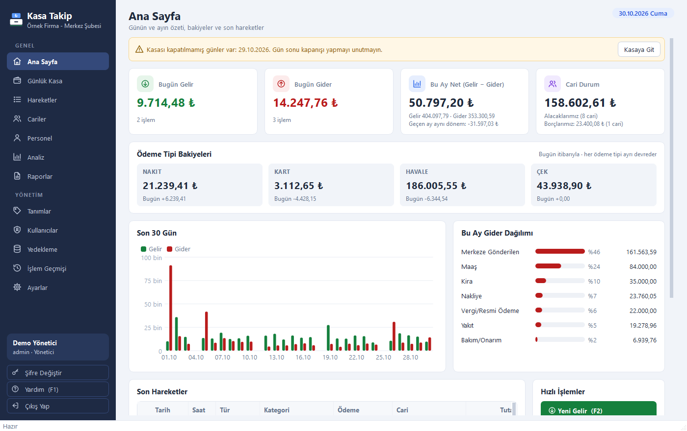
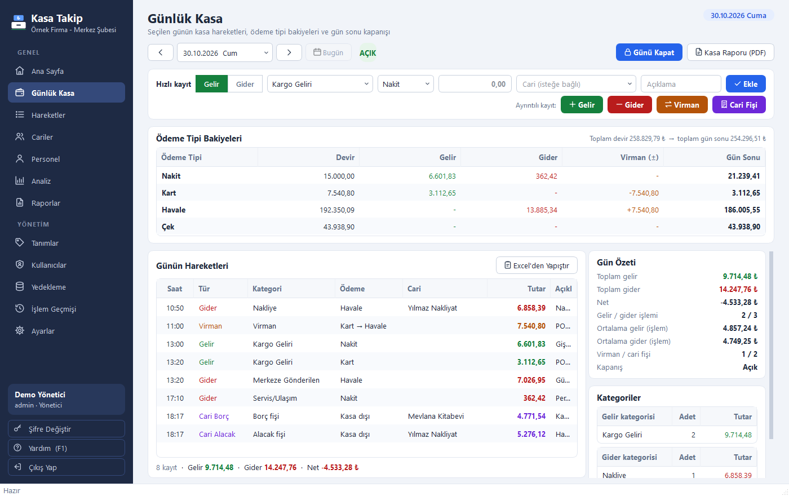
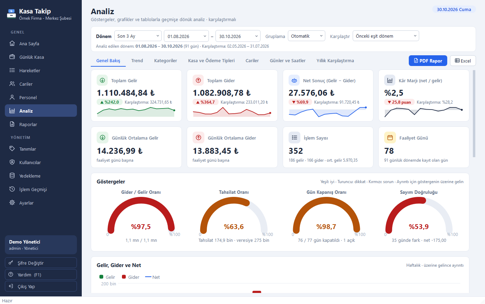
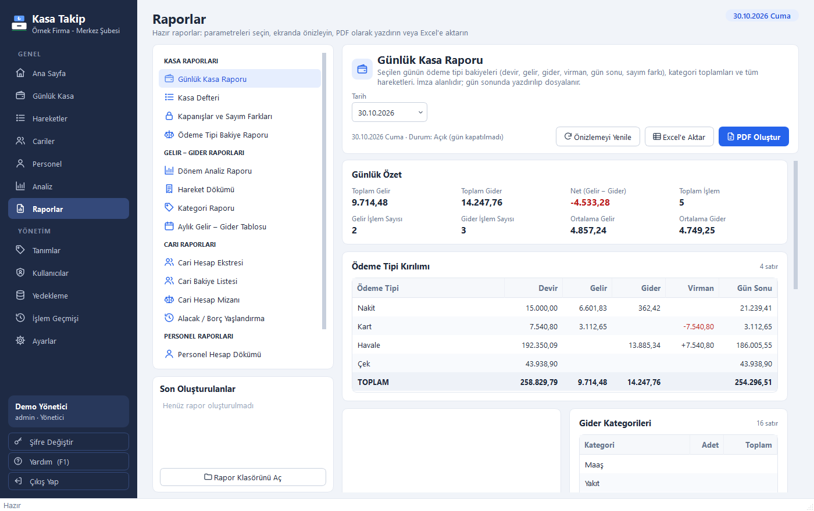

<div align="center">

# Kasa Takip

**Günlük kasa, cari hesap ve gelir-gider takibi için Windows masaüstü programı.**


-41CD52.svg)

</div>

Python + PySide6 (Qt) ile yazıldı; veriler şifreli tek bir dosyada tutulur, **internete hiç çıkmaz**. Küçük bir
şube ya da işletmenin günlük kasasını, müşteri/tedarikçi carilerini ve gelir-giderini takip etmek, gün sonunu
kapatmak, PDF ve Excel raporu almak için tasarlandı. Arayüz Türkçedir.

<table>
  <tr>
    <td align="center"><b>Ana sayfa</b><br></td>
    <td align="center"><b>Günlük kasa</b><br></td>
  </tr>
  <tr>
    <td align="center"><b>Analiz</b><br></td>
    <td align="center"><b>Raporlar</b><br></td>
  </tr>
</table>

> Ekran görüntüleri programın deneme modundaki uydurma verilerle alınmıştır.

## Hızlı başlangıç

```
git clone https://github.com/albatroshTR/kasa_takip_muhasebe.git
cd kasa_takip_muhasebe
demo_calistir.bat
```

64-bit Python 3.11 – 3.15 gerekir (3.13 önerilir). Betik sanal ortamı ve paketleri kendisi kurar; program örnek
verilerle açılır (kullanıcı **admin**, şifre **admin**). Ayrıntılar: [1. Hızlıca denemek](#1-hızlıca-denemek-kaynak-koddan),
EXE üretmek için: [2. EXE ve kurulum dosyası oluşturma](#2-exe-ve-kurulum-dosyası-oluşturma).

## Özellikler

- **Günlük Kasa**: seçilen günün hareketleri, her ödeme tipi için ayrı devreden bakiye
  (Devir → Gelir → Gider → Virman → Gün Sonu), hızlı kayıt satırı, gün sonu sayımı ve **Günü Kapat**.
- **Günlük kasa PDF raporu**: özet, ödeme tipi kırılımı, gelir/gider kategorileri, hareket dökümü, imza alanları.
- **Cariler**: müşteri ve tedarikçi hesapları, borç/alacak bakiyesi, ekstre (PDF/Excel), bakiye listesi.
- **Hareketler**: tüm kayıtlar; tarih, tür, kategori, ödeme tipi, cari ve metin/tutar ile filtreleme.
- **Analiz (gösterge paneli)**: 7 sekme — Genel Bakış (gösterge kartları, değişim oranları, küçük trend
  çizgileri, gider/gelir oranı, tahsilat oranı, gün kapanış oranı ve sayım doğruluğu göstergeleri, otomatik
  yorumlar), Trend, Kategoriler (karşılaştırma + kategori × dönem ısı tablosu), Kasa ve Ödeme Tipleri
  (bakiye seyri, sayım farkları), Cariler (alacak/borç yaşlandırma, mizan), Günler ve Saatler (takvim ısı
  haritası, haftanın günleri, saat yoğunluğu) ve Yıllık Karşılaştırma. Önceki eşit dönem veya geçen yılın aynı
  dönemiyle karşılaştırma; PDF ve Excel.
- **Raporlar**: 14 hazır rapor; parametre seçimi, ekranda canlı önizleme, PDF (yazdırma) ve Excel çıktısı
  (Kasa Defteri, Cari Mizan, Alacak Yaşlandırma, Aylık Gelir-Gider Tablosu vb. — liste aşağıda).
- **Personel** (yalnız yönetici): personel kartları ve cari gibi çalışan personel hesabı. **(A)** personele
  borçluyuz, **(B)** personel bize borçlu.
  - **Hak ediş** (maaş, prim, mesai…) kasayı etkilemez.
  - **Ödeme, avans, borç verme** kasadan çıkar.
  - **Geri ödeme** kasaya girer.
  - **Devreden bakiye** ile açılış girilir.
  - **Toplu Maaş** ekranında hak edişler ve ödemeler tek seferde girilir.
  - Kartta kime, ne zaman, ne kadar, hangi ödeme tipiyle, ne ödendiği listelenir; **Personel Hesap Dökümü** PDF ve
    Excel olarak alınır.
  - Kasayı etkileyen personel kayıtları Günlük Kasa'ya, Hareketler'e, Kasa Defteri'ne ve analize kendiliğinden
    işlenir.
- **Şifreli veri**: veritabanı ve tüm yedekler şifreli saklanır. Programdaki bir kullanıcının şifresi ya da
  **kurtarma anahtarı** olmadan, Windows hesabı şifresiz olsa bile açılamaz.
- **Tanımlar**: gelir/gider kategorileri ve ödeme tipleri eklenir, yeniden adlandırılır, sıralanır,
  pasif yapılır. Kullanılan tanım silinmez, geçmiş kayıtlar bozulmaz.
- **Kullanıcı adı / şifre**, iki rol: Yönetici ve Kullanıcı. Şifre unutulursa kurtarma anahtarı.
- **Kopyala-yapıştır**: tablolardan Excel'e uygun kopyalama (Ctrl+C), Excel'den yapıştırarak toplu
  hareket ve cari kaydı (Ctrl+V), kayıt çoğaltma.
- **Yedekleme**: oturum açılışında, program kapanışında ve her gün kapanışında otomatik yedek; aylık arşiv;
  isteğe bağlı ikinci kopya klasörü (USB bellek, OneDrive/Google Drive); tek tıkla geri yükleme.
- **İşlem geçmişi**: kim, ne zaman, neyi ekledi/değiştirdi/sildi.
- Deneme modu (`--demo`): gerçek veriye dokunmadan örnek verilerle deneme.
- **İnternete çıkmaz**: program hiçbir ağ bağlantısı kurmaz; açılışta programın ağ işlevleri kapatılır, EXE'ye Qt ağ
  modülü alınmaz ve kurulum Windows Güvenlik Duvarı'na programın dışarı/içeri bağlantısını engelleyen
  "Kasa Takip - internet engeli" kuralını ekler (kaldırınca silinir).

## Paket içeriği

```
kasa_takip_muhasebe/
  main.py               Programı başlatır
  kasatakip/            Program kodu (iş kuralları, veritabanı, raporlar, arayüz)
  assets/               İkon, yazı tipi (Liberation Serif, OFL lisanslı), simgeler
  tests/                Otomatik testler
  docs/screenshots/     README ekran görüntüleri
  tools/                python_bul.bat (uygun Python'u seçer), python_kontrol.py (64-bit / sürüm denetimi),
                        ortam.py (.venv'i kurar, onarır, doğrular), make_icon.py (ikon üretir)
  requirements.txt      Gerekli Python paketleri
  calistir.bat          Kaynak koddan çalıştır (EXE olmadan)
  demo_calistir.bat     Deneme verisiyle aç
  exe_olustur.bat       EXE + kurulum dosyası üret
  EXE_OLUSTURMA_PROMPT.md  VS Code yapay zekâ asistanı için EXE oluşturma talimatı
  KasaTakip.spec        PyInstaller ayarları
  kurulum.iss           Inno Setup kurulum betiği
  version_info.txt      EXE sürüm bilgisi
  LICENSE               MIT Lisansı
  LISANS.txt            Lisans özeti ve üçüncü taraf bileşenler
  CHANGELOG.md          Sürüm notları
  sifirdan_kurulum.bat  Bilgisayardaki tüm Kasa Takip verilerini siler (sıfırdan kurulum; EVET onayı ister)
```

## Sürüm notları

Bkz. [CHANGELOG.md](CHANGELOG.md).

## 1. Hızlıca denemek (kaynak koddan)

1. **64-bit Python 3.13** kurun: [python.org/downloads/windows](https://www.python.org/downloads/windows/)
   sayfasında Python 3.13 için **"Windows installer (64-bit)"**; kurulumda **"Add python.exe to PATH"** kutusunu
   işaretleyin (ya da komut satırında `winget install -e --id Python.Python.3.13`). 3.11 – 3.15 arası 64-bit
   sürümler de çalışır. **32-bit Python'a PySide6 (Qt) kurulamaz.** Betikler bilgisayardaki uygun Python'u
   kendisi seçer; uygun Python yoksa hangilerini bulduğunu ve neden uygun olmadığını yazar.
2. `demo_calistir.bat` dosyasına çift tıklayın. İlk seferde gerekli paketler indirilir (birkaç dakika).
   Program örnek verilerle açılır: kullanıcı **admin**, şifre **admin**.
3. Gerçek kullanım için `calistir.bat` (ilk açılışta kurulum ekranı gelir).

## 2. EXE ve kurulum dosyası oluşturma

1. `exe_olustur.bat` dosyasına çift tıklayın. Betik; sanal ortamı kurar, paketleri yükler, testleri çalıştırır,
   `dist\KasaTakip\KasaTakip.exe` dosyasını üretir ve EXE'nin kendi testini (`--selftest`) çalıştırır.
2. Bilgisayarda **Inno Setup** (6.3 veya 7) kuruluysa ([indir](https://jrsoftware.org/isdl.php)) aynı betik tek
   dosyalık kurulum programını da üretir: `Kurulum\KasaTakip_Kurulum_<sürüm>.exe`.
   Bu dosyayı kullanılacak bilgisayara kopyalayıp çalıştırmak yeterlidir (Python gerekmez).
   Kurulum masaüstü kısayolu, Başlat menüsü kısayolu ve "Deneme Modu" kısayolu oluşturur.
3. Inno Setup yoksa `dist\KasaTakip` klasörünü ZIP'leyip taşıyın ve içindeki `KasaTakip.exe`'yi çalıştırın.
4. **VS Code ile**: klasörü VS Code'da açın, yapay zekâ sohbetini ajan modunda (GitHub Copilot "Agent" veya
   Claude Code) açıp `EXE_OLUSTURMA_PROMPT.md` dosyasındaki metnin tamamını yapıştırın. Asistan aynı adımları
   terminalde tek tek çalıştırır, EXE'yi doğrular ve sonucu raporlar.

> **Windows SmartScreen uyarısı**: Program dijital olarak imzalı olmadığı için ilk açılışta
> "Windows bilgisayarınızı korudu" uyarısı çıkabilir. **Ek bilgi → Yine de çalıştır** ile açılır.

## 3. İlk açılış

1. **İlk kurulum** ekranında firma/şube adını (raporlarda görünür) ve yönetici hesabını belirleyin.
2. Ekranda gösterilen **kurtarma anahtarını** not edin. Yönetici şifresi unutulursa ve yedekler başka bilgisayarda
   açılırken gerekir. Veriler şifreli saklandığı için şifreler ve kurtarma anahtarı birlikte kaybolursa verilere
   ulaşılamaz.
3. **Tanımlar → Ödeme Tipleri**: her ödeme tipinin **açılış bakiyesini** girin
   (kasadaki nakit, bankadaki tutar, çek portföyü vb.). Devirler buradan başlar.
4. **Cariler**: mevcut müşteri ve tedarikçileri ekleyin. Excel'de listeniz varsa
   **Yapıştır** düğmesiyle toplu ekleyin; "Bakiye" sütunu (pozitif = bize borçlu, negatif = biz borçluyuz)
   açılış bakiyesi olarak işlenir.
5. **Kullanıcılar**: gerekiyorsa ikinci bir kullanıcı (Kullanıcı rolüyle) ekleyin.
6. **Personel**: liste ilk açılışta yüklenir. Yeni personel **Yeni Personel** ile eklenir. Programa geçtiğiniz gün
   açık olan avans/borç ya da ödenmemiş maaş, kartta **Devreden bakiye** olarak girilir.

**1.1.x'ten güncelleme**: program eski veritabanıyla açılır.
- Yönetici ilk kez giriş yapınca veriler o şifreyle şifrelenir, eski şifresiz dosyalar silinir ve yeni kurtarma
  anahtarı gösterilir.
- O ana kadar eski dosyaya dokunulmaz; gerekirse 1.1.x'e geri dönülebilir. Yönetici olmayan bir kullanıcı önce giriş
  yaparsa dosya o girişte yeni sürüme yükseltilir (şifreleme yine ilk yönetici girişinde yapılır).
- Eski kurtarma anahtarı geçersiz olur.
- Başka kullanıcılar varsa yönetici, Kullanıcılar ekranından onların şifresini bir kez sıfırlar.

## 4. Günlük kullanım

1. **Günlük Kasa** ekranı bugünle açılır. Kayıtları üstteki **hızlı kayıt** satırından girin:
   tür → kategori → ödeme tipi → tutar → (cari) → açıklama → **Enter**.
   Ayrıntılı kayıt için **F2** (gelir), **F3** (gider), **F4** (virman).
2. Gün sonunda kasayı sayın, **Günü Kapat**'a basın, sayılan tutarı yazın.
   Fark otomatik hesaplanır, kapanış yedeği alınır ve **günlük kasa raporu (PDF)** açılır.
3. Kapanan gün ve önceki günler kilitlenir. Düzeltme gerekirse yönetici **Günü Aç** ile kapanışı geri alır
   (işlem geçmişine yazılır).

Ana Sayfa'da kapatılmamış günler varsa uyarı çıkar.
Program içinde **Yardım (F1) → Yazdırılabilir Kılavuz (PDF)** ile bir sayfalık hızlı başlangıç kılavuzu
alınabilir; yazdırıp bilgisayarın yanında tutmak için uygundur.

## 5. Kayıt türleri

| Tür | Kasa bakiyesi | Cari hesap | Örnek |
|---|---|---|---|
| **Gelir** | Seçilen ödeme tipi artar | Cari seçilirse **alacak** (tahsilat) | Gişe tahsilatı, müşteriden havale |
| **Gider** | Seçilen ödeme tipi azalır | Cari seçilirse **borç** (ödeme) | Yakıt, kira, tedarikçiye ödeme |
| **Virman** | Bir ödeme tipinden diğerine | — | Nakdi bankaya yatırma, POS'un bankaya geçmesi |
| **Cari Borç** | Etkilemez | Borç | Müşteriye veresiye gönderim |
| **Cari Alacak** | Etkilemez | Alacak | Tedarikçinin veresiye faturası |

Cari bakiye = borç − alacak. **(B)**: cari bize borçlu, **(A)**: biz cariye borçluyuz.
Her ödeme tipinin (Nakit, Kart, Havale, Çek…) bakiyesi ayrı hesaplanır ve günden güne devreder.

### Personel kayıtları (yalnız yönetici, Personel ekranından)

| İşlem | Kasa | Personel hesabı | Defterde |
|---|---|---|---|
| **Hak Ediş** (Maaş, Prim/İkramiye, Fazla Mesai, Yol/Yemek, Tazminat/İzin Ücreti…) | Etkilemez | Alacak (personele borcumuz artar) | Yalnız personel kartında |
| **Ödeme** | Seçilen ödeme tipinden çıkar | Borç | Gider (kategori = kalem) |
| **Avans** / **Borç Verme** | Çıkar | Borç | Gider (Personel Avansı / Personele Borç) |
| **Geri Ödeme** (personel öder) | Girer | Alacak | Gelir (Personel Geri Ödemesi) |
| **Devreden Borç / Alacak** (açılış) | Etkilemez | Borç / Alacak | Yalnız personel kartında |

Personel bakiyesi = borç − alacak. **(A)**: personele borçluyuz, **(B)**: personel bize borçlu.
- Örnek: 5.000 avans verildi, ay sonunda 25.000 maaş hak edildi. Kartta "personele 20.000 borçluyuz" görünür;
  20.000 ödenince hesap sıfırlanır.
- Personel gideri analizde ödeme gününde sayılır; hak ediş gider sayılmaz.
- Kalem olarak gider kategorileri kullanılır. Yeni kalem eklemek için Tanımlar'da gider kategorisi açın.

## 6. Kopyala – yapıştır

- Tüm tablolarda satır seçip **Ctrl+C** → Excel'e yapıştırılabilir (tutarlar sayı olarak gider).
  **Ctrl+Shift+C** başlıklarla kopyalar; sağ tık menüsünde hücre / tüm tablo kopyalama da vardır.
- Excel'de satırları kopyalayıp **Günlük Kasa** veya **Hareketler** ekranında **Ctrl+V** ya da
  **Excel'den Yapıştır**: sütunlar başlıktan veya içerikten otomatik tanınır (Tarih, Tür, Kategori,
  Ödeme Tipi, Tutar, Gelir/Gider tutarı, Cari, Açıklama, Belge No). Önizlemede hatalı satırlar kırmızı
  gösterilir ve kaydedilmez; istenirse eksik kategori ve cariler otomatik açılır.
- Kayıt üzerinde sağ tık → **Kopyasını oluştur** ile aynı kaydı hızlıca tekrar girebilirsiniz.

## 7. Analiz ve raporlar

### Analiz ekranı

Üstte **dönem** (Bugün, Bu Ay, Son 3 Ay, Bu Yıl, Tüm Zamanlar, özel aralık…), **gruplama** (otomatik / günlük /
haftalık / aylık) ve **karşılaştırma** (önceki eşit dönem / geçen yılın aynı dönemi / yok) seçilir.

| Sekme | İçerik |
|---|---|
| Genel Bakış | Toplam gelir, gider, net, kâr marjı (değişim rozeti + trend çizgisi); günlük ortalamalar; Gider/Gelir oranı, Tahsilat oranı, Gün kapanış oranı, Sayım doğruluğu göstergeleri; gelir-gider-net grafiği; kategori dağılımı halkaları; **Öne Çıkanlar** (otomatik yorumlar) |
| Trend | Gelir, gider, net çizgileri (karşılaştırma dönemi kesikli), kümülatif net, kategorilerin dönemlere göre yığılmış dağılımı, dönem dökümü tablosu |
| Kategoriler | Halka grafik, bu dönem / karşılaştırma çubukları, kategori tablosu (adet, toplam, pay, ortalama, fark, değişim), kategori × dönem ısı tablosu |
| Kasa ve Ödeme Tipleri | Dönem başı/sonu toplam kasa, bakiye seyri grafiği, ödeme tipi özeti, gelirin/giderin ödeme tipine dağılımı, kapanışlar ve sayım farkları |
| Cariler | Alacaklarımız / borçlarımız, dönem tahsilatı ve veresiyesi, **yaşlandırma** (0–30, 31–60, 61–90, 91–180, 180+ gün; FIFO), en yüksek bakiyeler, cari mizan |
| Günler ve Saatler | Takvim ısı haritası (gelir / gider / net / işlem sayısı), haftanın günleri, saatlere göre işlem yoğunluğu, en yüksek gelirli/giderli günler |
| Yıllık Karşılaştırma | Seçilen yılın ayları önceki yılla yan yana grafik ve tablo; yılbaşından bugüne karşılaştırma |

Grafiklerin üzerine gelince ayrıntı görünür; tablolarda satıra çift tıklayınca ilgili gün (Günlük Kasa), cari
veya kayıt açılır. **PDF Rapor** seçili dönemin kapsamlı analiz raporunu üretir; **Excel** tüm tabloları aktarır.

### Raporlar ekranı

Soldan rapor seçilir, parametreler ayarlanır; rapor anında ekranda önizlenir. **PDF Oluştur** yazdırılabilir PDF'i
kaydedip açar, **Excel'e Aktar** özet ve tabloları Excel'e aktarır. Son oluşturulan raporlar listeden açılabilir.

| Rapor | Parametreler | İçerik |
|---|---|---|
| Günlük Kasa Raporu | Tarih | Ödeme tipi kırılımı, sayım farkı, kategoriler, hareketler, imza alanları |
| Kasa Defteri | Dönem, ödeme tipi, gün toplamları | Tarih sıralı giriş / çıkış / yürüyen bakiye (yatay sayfa) |
| Kapanışlar ve Sayım Farkları | Dönem | Kapatılan günler, kapatan, sayım farkları, kapatılmamış günler |
| Ödeme Tipi Bakiye Raporu | Dönem | Dönem başı/sonu, hareket özeti, bakiye seyri, gün sonu bakiyeleri |
| Dönem Analiz Raporu | Dönem, gruplama, karşılaştırma | Göstergeler, yorumlar, grafikler, kategoriler, ödeme tipleri, cariler, günler |
| Hareket Dökümü | Dönem, tür, kategori, ödeme tipi, cari, arama | Filtrelenmiş hareketler, gelir / gider toplamları |
| Kategori Raporu | Dönem, kapsam, gruplama, karşılaştırma | Dağılım, karşılaştırma, kategori × dönem tablosu |
| Aylık Gelir – Gider Tablosu | Yıl | 12 ay gelir/gider/net/kümülatif, önceki yıl, kategori × ay |
| Cari Hesap Ekstresi | Cari, dönem | Devir, hareketler, yürüyen bakiye, imza alanları |
| Cari Bakiye Listesi | Tarih itibarıyla, cari tipi | Toplam borç, alacak, bakiye, durum |
| Cari Hesap Mizanı | Dönem, cari tipi | Devir, dönem borç/alacak, bakiye |
| Alacak / Borç Yaşlandırma | Tarih itibarıyla, kapsam | Yaş dilimleri, en eski açık kalem, son tahsilat |
| İşlem Geçmişi Raporu (yönetici) | Dönem, kullanıcı | Kim, ne zaman, ne yaptı |
| Personel Hesap Dökümü (yönetici) | Personel, dönem | Devir, hak ediş / ödeme / avans / geri ödeme kayıtları, yürüyen bakiye; personel seçilmezse tüm personelin özeti |

Diğer ekranlardaki PDF/Excel düğmeleri de çalışmaya devam eder (Günlük Kasa → Kasa Raporu, Cariler → Ekstre,
Hareketler → Excel'e Aktar, Yedekleme → Tüm Verileri Excel'e Aktar).
Raporlar `Belgeler\KasaTakip\Raporlar` altına kaydedilir (Ayarlar'dan değiştirilebilir).

### Tüm defteri tek seferde Excel'e almak

- **Yedekleme → Tüm Verileri Excel'e Aktar**: bütün kayıtlar tek dosyada, her biri ayrı sayfa: Hareketler (tüm
  kayıtlar), Cariler (borç / alacak / bakiye), Kategoriler, Ödeme Tipleri (açılış ve güncel bakiye), Gün Kapanışları.
- **Raporlar → Kasa Defteri**, dönem **Tüm Zamanlar**, **Excel'e Aktar**: ilk kayıttan bugüne tarih sıralı giriş,
  çıkış ve yürüyen bakiye; gün toplamları ve dönem toplamı. Ödeme tipi seçilerek her kasanın (Nakit, Kart…) defteri
  ayrı alınabilir. **Hareket Dökümü** ve **Cari Hesap Mizanı** de aynı şekilde tüm zamanlar için alınabilir.

## 8. Yedekleme ve geri yükleme

- Otomatik yedek: oturum açılışı (6 saatte bir), program kapanışı, her gün kapanışı.
- Saklama: son 7 günün tüm yedekleri; daha eskiler için her günün son yedeği (varsayılan 90 gün);
  her ayın son hali `Aylık` klasöründe süresiz. Elle alınan yedekler hiç silinmez.
- **Ek kopya klasörü** (Yedekleme ekranı): USB bellek veya OneDrive/Google Drive klasörü seçin; her yedek
  oraya da kopyalanır. Bilgisayar arızasına karşı **mutlaka önerilir**.
- **Geri yükleme** (yalnız yönetici): listeden yedeği seçin. İşlemden önce mevcut durumun yedeği alınır.
  - Yedekler şifrelidir (`.kdb`).
  - Başka bir kuruluma ait yedek için o yedekteki bir kullanıcının şifresi ya da kurtarma anahtarı sorulur.
  - Yedekteki yönetici şifresi bugünkünden farklıysa yedeğin alındığı tarihteki yönetici şifresi istenir. O şifre
    hatırlanmıyorsa yerine kurtarma anahtarı yazılabilir; geri yüklemeden sonra giriş ekranında **Şifremi unuttum**
    ile bu anahtarla yeni yönetici şifresi belirlenir.
  - Geri yüklemeden sonra yedekteki şifreler geçerlidir.

## 9. Kullanıcılar ve yetkiler

| İşlem | Yönetici | Kullanıcı |
|---|---|---|
| Kayıt girme, düzenleme, silme (açık günlerde) | ✓ | ✓ |
| Günü kapatma, analiz, rapor alma, Excel'e aktarma | ✓ | ✓ |
| Cari ekleme / düzenleme | ✓ | ✓ |
| Kapanmış günü açma | ✓ | — |
| Tanımlar, kullanıcılar, ayarlar, geri yükleme, işlem geçmişi (ekran ve rapor) | ✓ | — |
| Personel ekranı, personel kayıtları ve Personel Hesap Dökümü | ✓ | — (kasadaki personel kayıtlarını isimsiz görür) |

Yeni kullanıcı ilk girişte kendi şifresini belirler. 5 hatalı denemede giriş 30 saniye bekletilir.

**Program sahibi:** İlk kurulumda açılan yönetici programın sahibidir (Kullanıcılar ekranında "Sahip" yazar; eski
veritabanlarında id'si en küçük aktif yönetici). Sahibin hesabını başka bir yönetici pasif yapamaz, rolünü değiştiremez,
şifresini sıfırlayamaz; sahip de kendini pasif yapamaz, yönetici yetkisini kaldıramaz. Ayarlar → Yeni Kurtarma Anahtarı
yalnızca sahibe açıktır. Sahip, Kullanıcılar ekranındaki **Sahipliği Devret** ile sahipliği başka bir aktif yöneticiye
verebilir. Giriş ekranındaki "Şifremi unuttum" değişmedi: kurtarma anahtarını bilen, bir yöneticinin şifresini
sıfırlayabilir.

## 10. Verilerin yeri

| Ne | Nerede |
|---|---|
| Veritabanı (şifreli) | `%LOCALAPPDATA%\KasaTakip\veri\kasa.kdb` |
| Yedekler (şifreli, `.kdb`) | `Belgeler\KasaTakip\Yedekler` |
| Raporlar | `Belgeler\KasaTakip\Raporlar` |
| Günlük (log) dosyaları | `%LOCALAPPDATA%\KasaTakip\log` |
| Deneme modu | Aynı yerlerde `KasaTakipDemo` / `KasaTakip Demo` klasörleri |

Canlı veritabanı bilerek bulut senkronizasyonu dışındadır (açık dosyanın senkronize edilmesi bozulmaya yol
açabilir); yedekler ise Belgeler'dedir. Programı kaldırmak verileri silmez.

## 11. Sorun giderme

- **"Kasa Takip zaten açık"**: program görev çubuğunda açık. Aynı anda iki pencere açılmasına izin verilmez.
- **PDF açılmıyor / kaydedilmiyor**: aynı adlı PDF bir görüntüleyicide açıksa program yeni bir adla kaydeder.
- **Excel'e aktarım hatası**: hedef dosya Excel'de açık olabilir; kapatıp tekrar deneyin.
- **Yönetici şifresi unutuldu**: giriş ekranında **Şifremi unuttum** → kurtarma anahtarı. Kurtarma anahtarı
  şifreli verileri de açar. Sıfırlamadan sonra yeni bir kurtarma anahtarı gösterilir: canlı veriler ve yeni yedekler
  onunla açılır. Daha önce alınmış yedekler başka bilgisayarda eski anahtarla açılır; eski anahtarı da saklayın.
  (Ayarlar → Yeni Kurtarma Anahtarı Oluştur için de aynısı geçerlidir.)
- **Yeni bilgisayar / arıza**: programı kurun ve ilk kurulumu yapın, sonra **Yedekleme → Geri Yükle** ile son yedeği
  seçin. Yedeğin alındığı tarihteki bir kullanıcı şifresi ya da kurtarma anahtarı sorulur; geri yüklemeden sonra o
  yedeğin şifreleri geçerlidir. Başka bir yol: şifreli `.kdb` yedeğini `%LOCALAPPDATA%\KasaTakip\veri\kasa.kdb`
  adıyla koyup yedekteki şifreyle giriş yapmak. 1.1.x'in şifresiz `.db` yedeği ise **Yedekleme → Geri Yükle** ile
  yüklenir ya da aynı klasöre `kasa.db` adıyla konur (ilk yönetici girişinde şifrelenir); `kasa.kdb` adıyla konursa
  program onu `kasa.db` yapar, yanında `kasa.db` de varsa açılmaz.
- **"Bu kullanıcıların şifresini sıfırlayın" uyarısı**: bu kullanıcılar şifreli dosyayı kendi şifreleriyle henüz
  açamıyor (ör. 1.1.x'ten gelen kullanıcılar). Kullanıcılar ekranından şifrelerini bir kez sıfırlayın. Giriş ekranında
  bu kullanıcılara "kilidi yok" yazılır. Adları yalnızca Türkçe harflerle ayrılan kullanıcılar (ör. "Şule" ve "sule")
  aynı kilidi paylaşır; bunların şifresi sıfırlanamaz, değiştirilemez. Önce birini pasif yapın, sonra kalanın şifresini
  sıfırlayın.
- **Beklenmeyen hata**: ayrıntı log dosyasına yazılır (Ayarlar → Günlük (log) Klasörü).
- **"No matching distribution found for PySide6"** (calistir.bat / exe_olustur.bat): Python 32-bit, desteklenmeyen
  bir sürüm ya da pip şirket içi bir paket deposuna yönlendirilmiş. 64-bit Python 3.13 kurup betiği tekrar
  çalıştırın; eski sanal ortam (`.venv`) otomatik yenilenir. Şirket bilgisayarında betik pip ayarlarını da
  yazar (şifreler gizlenir); gerekirse bilgi işlemden PyPI erişimi isteyin.

## 12. Geliştirici notları

- Testler: `python -m tests.test_personel` (personel hesabı), `python -m tests.test_gecis` (1.1.x'ten geçişte
  kurtarma anahtarı), `python -m tests.test_sifreleme` (şifreli veri,
  kilitler, geçiş, yedek), `python -m tests.test_core` (iş kuralları, analiz, raporlar), `python -m tests.gui_flow` (arayüz
  akışları), `python -m tests.gui_exit` (gerçek açılış/kapanış; pencere ömrü ve kapanışta çökme olmaması) ve
  `python -m tests.gui_smoke çıktı_klasörü` (ekran görüntüleri). Arayüz testleri ekransız çalışır.
- Tutarlar veritabanında **kuruş** cinsinden tam sayı tutulur (yuvarlama hatası olmaz).
- Şifreler PBKDF2-SHA256 ile özetlenir; düz metin saklanmaz.
- Şifreleme: `sifreleme.py` (kap biçimi: JSON başlık + AES-256-GCM; kullanıcı ve kurtarma kilitleri scrypt ile).
  `db.py` veriyi bellekte tutar ve her kayıttan sonra şifreli dosyayı güvenli biçimde yeniden yazar. Bağımlılık:
  `cryptography`.
- Bilinen sınırlar (bilerek değiştirilmedi):
  - Şifre en az 4 karakterdir. Kısa şifre, dosya ele geçirilirse tahminle açılmasını kolaylaştırır; uzun şifre önerilir.
  - Şifre değişince, kullanıcı pasif yapılınca ya da kurtarma anahtarı yenilenince veri anahtarı yenilenmez; yalnızca
    eski kilit sonraki dosyalardan kalkar. Eski şifreyle (ya da eski anahtarla) açılan eski bir yedekten veri anahtarını
    alan biri sonraki dosyaları da çözebilir.
- Personel: `personel_schema.py` (şema v2), `personel_listesi.py` (isteğe bağlı ilk liste; boş gelir), `ui/pages/personel.py`,
  `ui/personel_dialogs.py`; hak ediş ve devreden kayıtları `personel_fisleri` tablosundadır (kasa dışı).
- Kod yapısı: `services.py` (iş kuralları), `db.py` (şema), `backup.py`, `analytics.py` (analiz hesapları),
  `reports.py` + `report_model.py` (rapor tanımları ve içerik), `reports_pdf.py`, `excel.py`,
  `paste.py` (yapıştırma çözümleme), `ui/` (arayüz; grafikler `ui/charts.py`).
- Raporlar bloklardan (özet, tablo, grafik, yorum) oluşur; aynı içerik ekranda önizlenir, PDF'e ve Excel'e aktarılır.
  Yeni rapor eklemek için `reports.py` içinde bir `ReportDef` tanımlamak yeterlidir.
- PDF yazı tipi: Windows'ta Times New Roman, yoksa paketle gelen Liberation Serif.
- Ağ engeli: `kasatakip/netguard.py` (açılışta `app.main` çağırır); güvenlik duvarı kuralı `kurulum.iss` [Code]
  bölümünde. Taşınabilir EXE'de kurulum olmadığı için yalnızca programın kendi engeli geçerlidir.

## 13. Lisans ve katkı

Kasa Takip açık kaynaklıdır ve **MIT Lisansı** ile dağıtılır ([LICENSE](LICENSE)). © 2026 Tahir Ekinalan
([tahirekinalan.com](https://tahirekinalan.com)). Programda kullanılan üçüncü taraf bileşenlerin lisansları:
[LISANS.txt](LISANS.txt).

Hata bildirimi ve öneriler için [Issues](https://github.com/albatroshTR/kasa_takip_muhasebe/issues), kod katkısı için
pull request açabilirsiniz. Göndermeden önce `python -m tests.test_core` ve ilgili diğer testleri çalıştırın
(bkz. [12. Geliştirici notları](#12-geliştirici-notları)). Gerçek müşteri ya da personel verisi, kurtarma anahtarı
veya veritabanı dosyası (`.kdb`) paylaşmayın.

## Geliştirme hakkında

Bu proje yapay zekâ destekli geliştirildi ("vibe coding"; Claude Code ile). Yazılımcı olmayan bir kullanıcının
ihtiyacından doğdu ve 680'den fazla otomatik kontrolle doğrulanıyor. Yine de finansal veri tuttuğu için gerçek
kullanımdan önce kendi verinizle deneyin ve düzenli yedek alın. Kod inceleme, hata bildirimi ve katkılar
memnuniyetle karşılanır.
